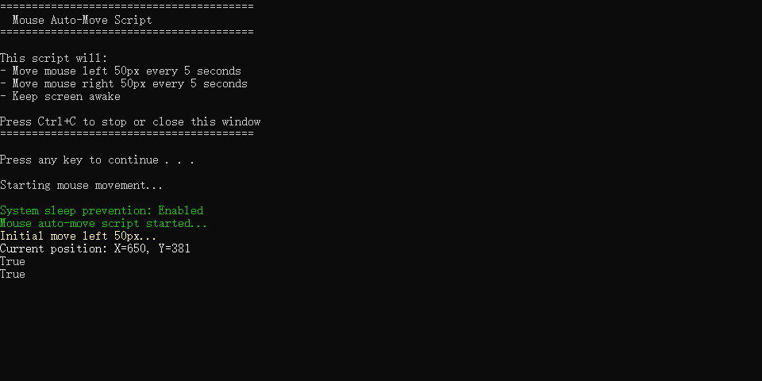

# 鼠标自动移动防闲置脚本（Idle-Mouse-Move）



**控制面板被锁？电源选项被灰掉？显示屏设了"从不"还是灭？**


不用管理员权限，不用改任何系统设置，双击 `start.bat`，屏幕就不灭。


关掉窗口，一切恢复原样。


## 📌 介绍
### 谁需要这个
- **公司电脑被组策略锁死** — 控制面板进不去，电源计划改不了，5 分钟锁屏
- **显示屏/一体机固件不遵守设置** — 系统设了"从不"，它照样自己灭
- **远程桌面保活** — 本地一睡 RDP 就断，API 被拦还有鼠标微动兜底
- **给不会用电脑的人** — 长辈、同事、实验室访客，教不会 powercfg，给个 bat 就行

### ❓ 为什么不用电源选项
| 场景 | 电源选项 | 本工具 |
|------|----------|--------|
| 组策略锁死控制面板 | ❌ 改不了 | ✅ 双击就跑 |
| 固件覆盖系统设置 | ❌ 被无视 | ✅ API + 鼠标兜底 |
| 需要管理员权限 | ❌ 没权限 | ✅ 普通用户 |
| 改完想恢复原样 | ❌ 得记回去 | ✅ 关窗口就行 |


### 🎨 这个脚本有什么、做什么
- 鼠标往复移动：向左偏移指定像素，等待一段时间后返回，循环执行
- 内置真正的系统防休眠API，阻止系统睡眠以及显示器自动关闭
- 纯本地运行，无需联网，调用 Windows API 实现光标控制与电源管理
- 双版本：正式版（无磁盘日志）、调试版（输出坐标日志，用于排错）


## 📁 文件说明
### `mouse_move.ps1` - **【主脚本｜正式使用版本】**
- 用途：日常挂机使用，仅控制台输出信息，**不会写入磁盘日志文件**
- 功能：鼠标往复移动 + 启用系统防休眠（`SetThreadExecutionState`）
- 配套启动入口：`run_mouse_move.bat`

### `run_test.ps1` - **【调试脚本｜排错使用】**
- 用途：问题排查调试，在脚本同目录生成 `mouse_log.txt`，记录每一轮鼠标坐标
- 功能：鼠标往复移动 + 启用系统防休眠 + 磁盘日志记录
- 注意：会持续写入磁盘日志，**不适合长时间挂机使用**
- 配套启动入口：`run_test.bat`

### `run_mouse_move.bat`
正式启动批处理脚本，双击运行主脚本 `mouse_move.ps1`。
> 批处理内提示 `Keep screen awake` 与脚本实际行为保持一致，脚本内部已开启防休眠。
停止方式：控制台窗口按下 `Ctrl+C`，或者直接关闭控制台窗口。

### `run_test.bat`
调试启动批处理，运行调试脚本，生成日志文件并开启防休眠。

### `mouse_log.txt`
> **仅运行 `run_test.ps1` 才会生成该文件，正式主脚本不会产生。**
> 内容包含时间戳、循环序号、鼠标移动前后坐标；文件为追加写入模式，不会自动覆盖旧日志。

## 🚀 使用方法
### 方法一：双击启动（推荐）
1. 日常挂机：直接双击 `run_mouse_move.bat`
2. 需要查看移动日志用于排错：双击 `run_test.bat`
3. 终止脚本：按下 `Ctrl+C`，或者关闭控制台窗口

### 方法二：命令行手动运行
```cmd
:: 运行正式主脚本
cd 脚本所在文件夹
run_mouse_move.bat

:: 运行调试脚本
run_test.bat
```

### 方法三：直接调用PowerShell执行脚本
```powershell
# 正式版
powershell -NoProfile -ExecutionPolicy Bypass -File mouse_move.ps1

# 调试版
powershell -NoProfile -ExecutionPolicy Bypass -File run_test.ps1
```

## ⚙️ 参数配置
编辑对应ps1文件修改参数：

**mouse_move.ps1（正式版）**
```powershell
$moveAmount = 50        # 单次移动像素距离
$leftMoveTime = 5000    # 左移完成后等待毫秒数
$rightMoveTime = 5000   # 返回完成后等待毫秒数
```

**run_test.ps1（调试版）**
```powershell
$moveAmount = 50        # 单次移动像素距离
$leftTime = 5000        # 左移完成后等待毫秒数
$rightTime = 5000       # 返回完成后等待毫秒数
```

## 🔧 常见问题
### Q1：鼠标完全不移动？
A：逐项排查：
1. 安全软件拦截了脚本调用Windows鼠标API；
2. 使用调试脚本 `run_test.bat`，查看 `mouse_log.txt` 判断脚本是否正常执行。

### Q2：开了脚本屏幕还是灭？
A：少数机型/厂商电源管理会覆盖`ES_DISPLAY_REQUIRED`。此时**去控制面板 → 电源选项 → 更改计划设置 → 关闭显示器/使计算机进入睡眠状态 → 从不（合盖场景再把“关闭盖子时”设为“不采取任何操作”）**即可

### Q3：找不到 mouse_log.txt？
A：日志文件**只有调试脚本 run_test.ps1 才会输出**，正式主脚本不会生成日志。

### Q4：运行一段时间鼠标位置慢慢偏移？
A：脚本采用相对位移逻辑，没有锁定初始原点。运行期间尽量不要手动移动鼠标。

## 📝 技术细节
1. 光标控制：user32.dll 的 `SetCursorPos`、`GetCursorPos`
2. 防休眠实现：kernel32.dll 的 `SetThreadExecutionState`
    - 标志：`ES_CONTINUOUS | ES_SYSTEM_REQUIRED | ES_DISPLAY_REQUIRED`
    - 作用：阻止系统进入睡眠，阻止显示器自动关闭；进程结束自动失效。

## ⚖️ 免责声明
本脚本仅供学习测试使用。使用本脚本带来的一切问题，包括但不限于系统异常、鼠标行为异常等，由使用者自行承担风险。请勿用于游戏挂机或违规用途，部分游戏会检测模拟输入行为。

## 📄 作者与AI生成声明
- 初始代码草稿由 **GLM‑4.7‑Flash** 生成；
- README.md、描述、.gitignore和一部分代码审查由**豆包**和**元宝**处理；
- 另一部分代码审查由**dot-idk-dot**和**LLLyyy-star**测试
- 版本：1.0.2
- 最后一次更改：2026.11.20
