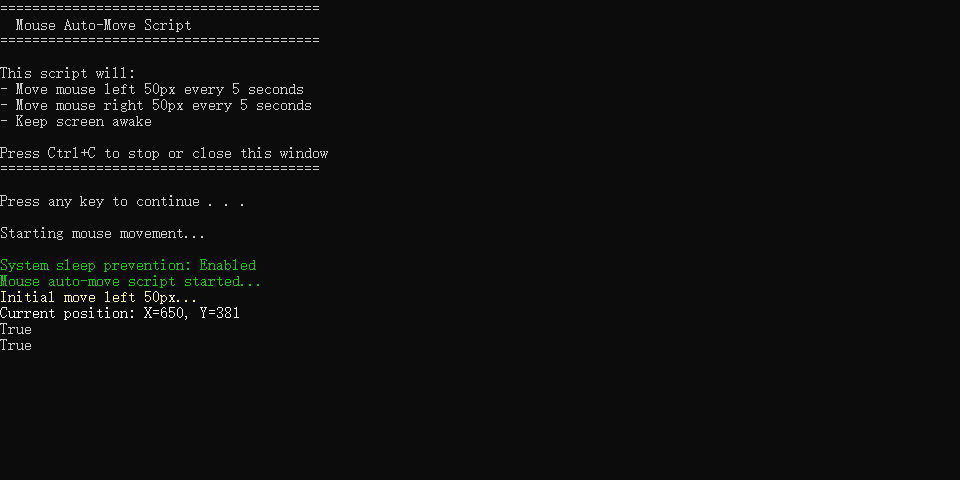

# Idle-Mouse‑Move



**Control panel locked? Power options grayed out? Display set to "Never" but still turns off?**


No admin rights needed. No system settings changed. Double-click `start.bat` and your screen stays on.


Close the window and everything goes back to normal.


## 📌 Introduction
### Who Needs This
- **Company computers locked by group policy** — Can't open Control Panel, can't change power plans, forced lock screen every 5 minutes
- **Displays/all-in-ones with firmware that ignores settings** — System says "Never", but the screen still turns off anyway
- **Remote desktop keep-alive** — RDP drops the moment the local machine sleeps; when the API is blocked, mouse movement fallback has you covered
- **For people who aren't tech-savvy** — Elders, colleagues, lab visitors — can't teach them `powercfg`, just give them a bat file


### ❓ Why Not Just Use Power Options?
| Scenario | Power Options | This Tool |
|----------|---------------|-----------|
| Group policy locks Control Panel | ❌ Can't change | ✅ Double-click and run |
| Firmware overrides system settings | ❌ Ignored | ✅ API + mouse fallback |
| Requires admin rights | ❌ No permission | ✅ Regular user |
| Want to revert changes afterward | ❌ Must remember original settings | ✅ Just close the window |


### 🎨 What's Included & What It Does
- **Mouse back-and-forth movement** — Shifts cursor left by a set number of pixels, waits, then returns, looping continuously
- **Built-in real system anti-sleep API** — Prevents system sleep and automatic display turn-off
- **Pure local execution** — No internet required; calls Windows APIs for cursor control and power management
- **Two versions** — Stable (no disk logging) and Debug (outputs coordinate logs for troubleshooting)

## 📂 File List
### `mouse_move.ps1` - **【Main Script｜Release Version】**
- Purpose: Daily idle usage, only console output, **will not write log files to disk**
- Features: Reciprocating mouse movement + enable system sleep prevention (`SetThreadExecutionState`)
- Matching launcher: `run_mouse_move.bat`

### `run_test.ps1` - **【Debug Script｜For Troubleshooting】**
- Purpose: Issue diagnosis and debugging, generate `mouse_log.txt` under script directory to record mouse coordinates of each loop
- Features: Reciprocating mouse movement + enable system sleep prevention + disk log recording
- Notice: Continuously write logs to disk, **not suitable for long‑time idle running**
- Matching launcher: `run_test.bat`

### `run_mouse_move.bat`
Release batch launcher, double‑click to run main script `mouse_move.ps1`.
> The prompt `Keep screen awake` inside batch matches actual script behavior, sleep‑prevention is enabled inside script.
Stop method: Press `Ctrl+C` in console window, or close console window directly.

### `run_test.bat`
Debug batch launcher, run debug script, generate log file and enable sleep prevention.

### `mouse_log.txt`
> **Only generated when running `run_test.ps1`. Release main script will NOT produce this file.**
> Contains timestamp, loop counter, mouse coordinates before and after movement; file uses append‑write mode, old logs will not be overwritten automatically.

## 🚀 Usage
### Method 1: Double‑click to launch (Recommended)
1. Daily idle: double‑click `run_mouse_move.bat`
2. Need debug logs for troubleshooting: double‑click `run_test.bat`
3. Terminate script: press `Ctrl+C`, or close console window

### Method 2: Run manually via command‑line
```cmd
:: Run release main script
cd script‑folder
run_mouse_move.bat

:: Run debug script
run_test.bat
```

### Method 3: Execute PowerShell script directly
```powershell
# Release version
powershell -NoProfile -ExecutionPolicy Bypass -File mouse_move.ps1

# Debug version
powershell -NoProfile -ExecutionPolicy Bypass -File run_test.ps1
```

## ⚙️ Parameter Configuration
Edit corresponding ps1 file to modify parameters:

**mouse_move.ps1 (Release Version)**
```powershell
$moveAmount = 50        # Pixel distance for single movement
$leftMoveTime = 5000    # Milliseconds to wait after moving left
$rightMoveTime = 5000   # Milliseconds to wait after moving back
```

**run_test.ps1 (Debug Version)**
```powershell
$moveAmount = 50        # Pixel distance for single movement
$leftTime = 5000        # Milliseconds to wait after moving left
$rightTime = 5000       # Milliseconds to wait after moving back
```

## 🔧 FAQ
### Q1: Mouse does not move at all?
A: Troubleshoot item by item:
1. Security software blocks script calling Windows mouse API;
2. Use debug script `run_test.bat`, check `mouse_log.txt` to judge whether script runs normally.

### Q2: Why does my screen still turn off even with the script running?​
A: On some machines, vendor power management can override `ES_DISPLAY_REQUIRED`. To fix this, **go to Control Panel → Power Options → Change plan settings, set Turn off the display​ and Put the computer to sleep​ to Never​ (for laptops, also set When I close the lid​ to Do nothing)**.

### Q3: Cannot find mouse_log.txt?
A: Log file **is only output by debug script run_test.ps1**, release main script will not generate logs.

### Q4: Mouse position drifts gradually after running for a while?
A: Script uses relative displacement logic without locking initial origin. Try not to move mouse manually while script is running.

## 📝 Technical Details
1. Cursor control API: `SetCursorPos`, `GetCursorPos` from user32.dll
2. Sleep‑prevention implementation: `SetThreadExecutionState` from kernel32.dll
    - Flags: `ES_CONTINUOUS | ES_SYSTEM_REQUIRED | ES_DISPLAY_REQUIRED`
    - Effect: Prevent system sleep and monitor auto‑off; automatically invalid after process exits.

## ⚖️ Disclaimer
This script is for learning and testing only. You shall bear all risks for any consequences caused by using this script, including but not limited to system exception, abnormal mouse behavior. Do not use for game AFK or any misuse, some games detect simulated input behavior.

## 📄 Author & AI Generation Notice
- Initial code draft generated by **GLM‑4.7‑Flash**;
- README.md, description, .gitignore and partial code review processed by **Doubao** and **元宝**;
- Additional code review done by **dot‑idk‑dot** and **LLLyyy‑star** for testing
- Version: 1.0.2
- Last modified: 2026‑11‑20(YYYY-MM-DD)